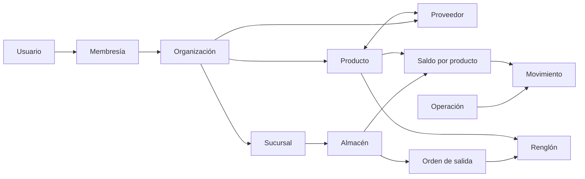

# Modelo Conceptual

## Límites del dominio

WareOps se divide en identidad, organizaciones, ubicaciones, catálogo, inventario, órdenes, auditoría y supervisión. `Organization` es el límite de seguridad; ninguna relación de negocio puede cruzarlo.

## Agregados y consistencia

- **Organización:** membresías e invitaciones; protege que siempre exista un propietario activo.
- **Catálogo:** producto, proveedor y su relación; aplica unicidad de SKU.
- **Inventario:** saldo como estado actual, operación como cabecera del comando y movimiento como línea inmutable de cambio.
- **Transferencia:** coordina dos saldos dentro de una única transacción.
- **Orden de salida:** raíz de sus renglones y de las transiciones que reservan o consumen inventario.

Las fronteras son conceptuales: el backend será un monolito modular y puede coordinar varios agregados mediante servicios transaccionales de Prisma.

## Cálculos derivados

- `available = onHand - reserved`.
- Una alerta de mínimo existe si el saldo está activo para operar y `available <= minimumStock`.
- Los conteos del dashboard se calculan sólo con datos de la organización activa.

El modelo físico se detalla en [[../04 Base de Datos/Diseño Lógico|Diseño lógico]] y [[../07 Diagramas/Modelo ER|Modelo ER]].
