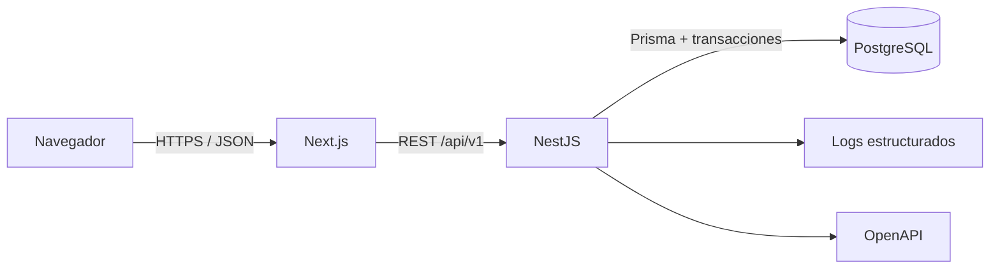

# Arquitectura del Sistema

## Enfoque

WareOps usa tres repositorios independientes: documentación, API y web. La API es un monolito modular NestJS que concentra reglas y transacciones; Next.js ofrece la interfaz; PostgreSQL es la fuente de verdad. Esta forma demuestra límites claros sin el costo operativo de microservicios.

## Responsabilidades

- La web gestiona navegación, formularios, presentación, caché de servidor y estado efímero; no decide permisos ni saldos.
- La API valida identidad, tenant, permisos y datos, ejecuta casos de uso y publica un contrato OpenAPI.
- PostgreSQL garantiza persistencia, FK, unicidad, aislamiento y atomicidad a través de operaciones generadas por Prisma.
- Docker Compose levanta el entorno local. Redis no participa en el MVP.

## Flujo de una solicitud protegida

1. El cliente envía access token, `X-Organization-Id` y `X-Request-Id` opcional.
2. La API autentica al usuario y valida una membresía activa.
3. El guard de permisos autoriza la acción.
4. El módulo valida recursos y tenant, ejecuta el caso de uso y su transacción.
5. La respuesta incluye el `requestId`; los logs y auditoría permiten correlación.

## Principios

- Dependencias desde controladores hacia servicios de aplicación y repositorios, nunca al revés.
- Reglas críticas en servicios de dominio y restricciones declarables en `schema.prisma`.
- Datos de una organización filtrados desde la entrada del repositorio.
- Operaciones físicas y reservadas trazables mediante cabeceras y movimientos normalizados.
- OpenAPI como contrato de integración y tipos web generados o verificados desde él.

Véase [[Backend]], [[Frontend]], [[Autenticación y Seguridad]] y [[../09 ADR/Índice de ADR|ADR]].
