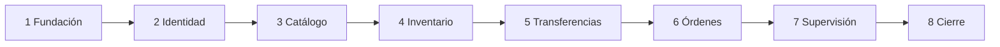

# Roadmap de Desarrollo

## Fase 1 — Base segura

Los sprints 1 y 2 crean repositorios ejecutables, automatización, autenticación, tenant y permisos. Al finalizar, un usuario puede entrar, cambiar de organización y administrar miembros sin fugas de datos.

## Fase 2 — Operación de inventario

Los sprints 3 a 6 entregan catálogos, saldos, movimientos, transferencias y órdenes mediante cortes verticales de API y web. Cada incremento debe ser demostrable antes de avanzar.

## Fase 3 — Supervisión y publicación

Los sprints 7 y 8 añaden dashboard, auditoría, accesibilidad, volumen de prueba, E2E y despliegue. El resultado debe contar una historia técnica verificable, no sólo mostrar pantallas.

## Secuencia

El detalle y la trazabilidad están en [[Plan de Sprints]].
