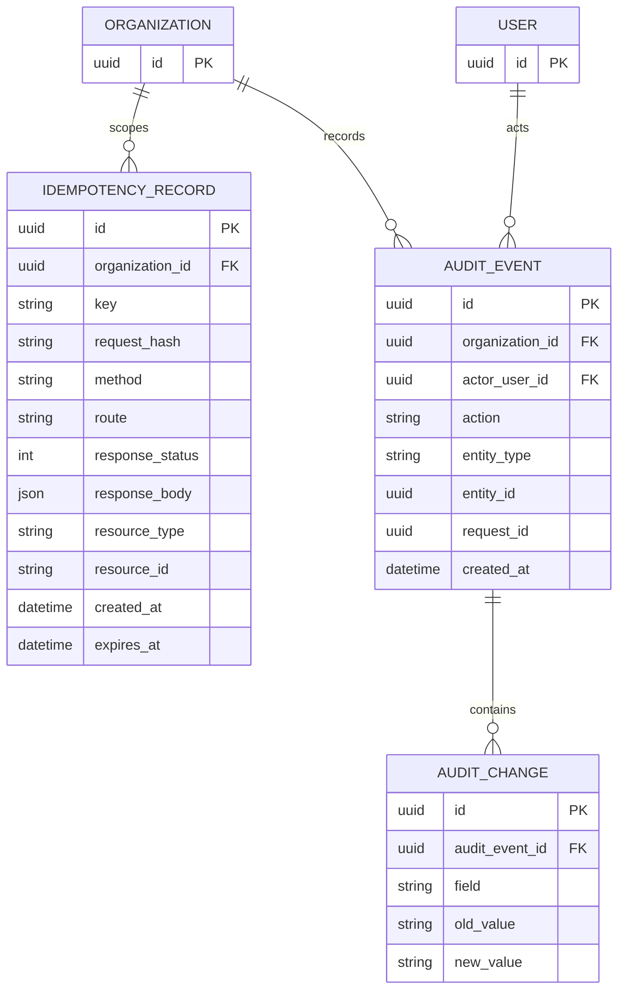

# ER — Idempotencia y Auditoría

Claves compuestas: registro idempotente por organización/clave y cambio único por evento/campo. `responseBody` es un resultado técnico opaco; auditoría relacionaliza cada cambio.
