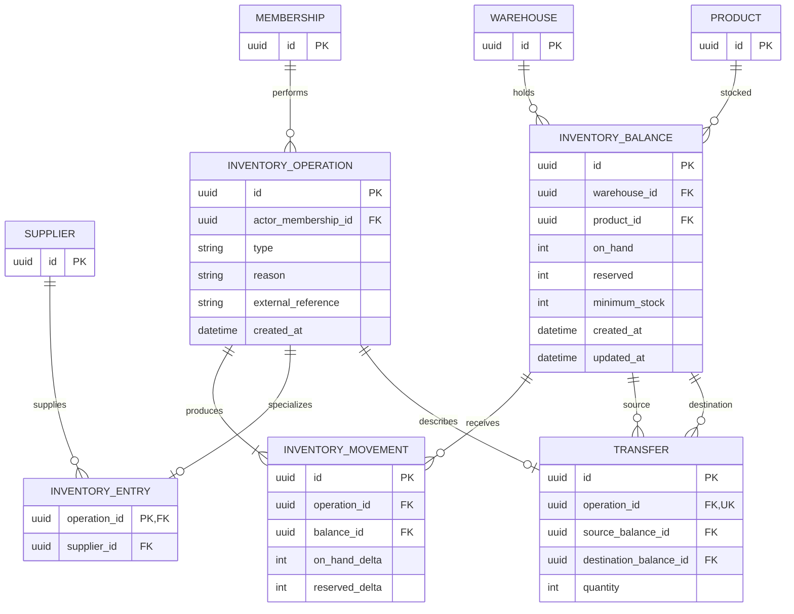

# ER — Inventario y Transferencias

Claves compuestas: `InventoryBalance(warehouseId, productId)` e `InventoryMovement(operationId, balanceId)`. Producto, almacenes, membresía y proveedor deben resolver al mismo tenant antes de escribir.
