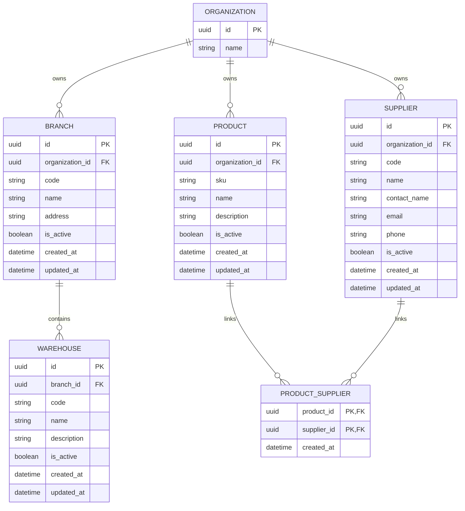

# ER — Ubicaciones y Catálogo

Claves compuestas: sucursal por organización/código, almacén por sucursal/código, producto por organización/SKU, proveedor por organización/código y producto–proveedor.
