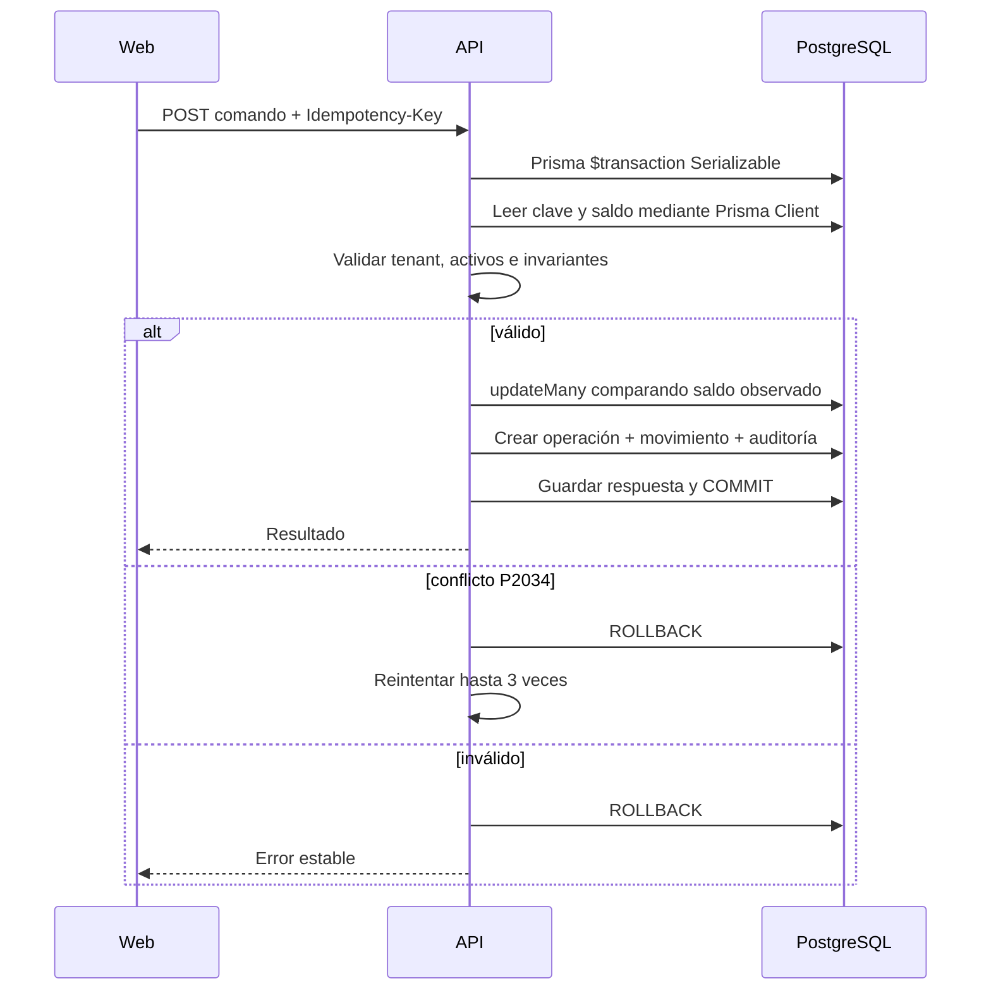
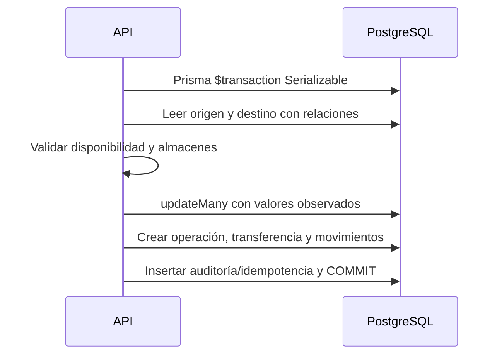
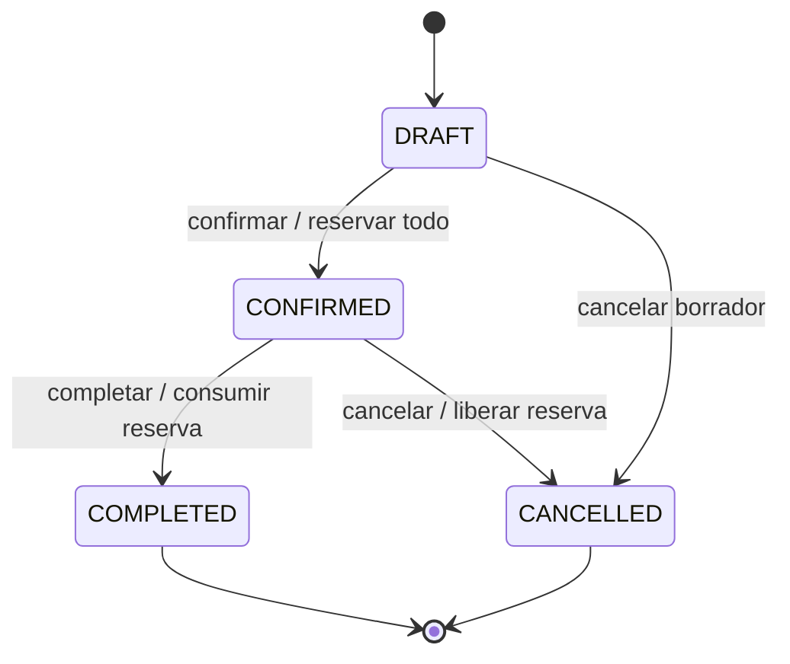

# Flujos Críticos

## Inicio y renovación de sesión

```mermaid
sequenceDiagram
    actor U as Usuario
    participant W as Web
    participant A as API (/api/v1)
    participant D as PostgreSQL
    U->>W: Registro o inicio de sesión
    W->>A: POST /auth/register o POST /auth/login
    A->>D: Verificar Argon2id / crear User + Organization + Membership(OWNER) + RefreshSession(tokenHash)
    A-->>W: 201/200 { data: { accessToken, user, organizations } } + Set-Cookie HttpOnly (wareops_refresh_token)
    W->>A: Solicitud protegida con Bearer JWT + X-Organization-Id
    A->>D: Verificar RefreshSession vigente + Membership ACTIVE + RolePermission
    A-->>W: Respuesta aislada al tenant activo
    W->>A: POST /auth/refresh (Cookie HttpOnly + Origin permitido)
    A->>D: Validar sessionId/tokenHash; si reutiliza token rotado revoca sesión; si válido rota tokenHash
    A-->>W: 200 Nuevo accessToken + nueva Cookie HttpOnly
    W->>A: POST /auth/logout (Bearer JWT)
    A->>D: Marcar RefreshSession.revokedAt y limpiar Cookie
    A-->>W: 200 { data: { loggedOut: true } }
```

## Operación idempotente de inventario



## Transferencia



## Ciclo de orden


