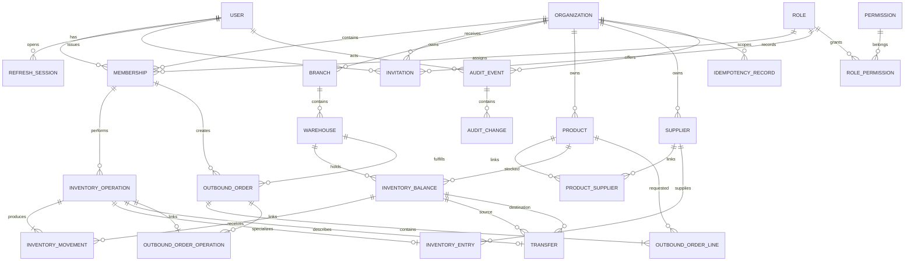

# Modelo ER Maestro

Este diagrama muestra las 24 tablas persistentes en 3FN. Los atributos y claves aparecen en los diagramas por módulo.

## Diagramas detallados

- [[ER - Identidad y RBAC]]
- [[ER - Ubicaciones y Catálogo]]
- [[ER - Inventario y Transferencias]]
- [[ER - Órdenes y Reservas]]
- [[ER - Idempotencia y Auditoría]]

Véase [[../04 Base de Datos/Diccionario de Datos|Diccionario de datos]] y [[../04 Base de Datos/Normalización a Tercera Forma Normal|Normalización a 3FN]].
