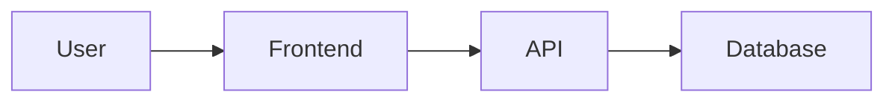

# Project Documentation Agent

This repository contains the project documentation and Obsidian vault.

The documentation must remain organized, consistent, and useful throughout the entire lifecycle of the project.

The goal is to document:

- What the product does.
- Why it exists.
- What requirements it must satisfy.
- What business rules govern it.
- How the system is designed.
- How data is modeled.
- How the API works.
- How the system is deployed.
- What decisions were made and why.
- What remains to be built.

---

# Documentation Structure

All project documentation should follow this structure:

ProjectName/
├── 00 Inicio/
├── 01 Producto/
├── 02 Requisitos/
├── 03 Dominio/
├── 04 Base de Datos/
├── 05 Arquitectura/
├── 06 Roadmap/
├── 07 Diagramas/
├── 08 API/
└── 09 ADR/

Do not create new top-level folders unless there is a strong reason.

Prefer extending the existing structure.

---

# 00 Inicio

Purpose:

Provide orientation and navigation for the documentation.

Recommended documents:

- ProjectName - Índice.md
- Glosario.md
- Decisiones y Supuestos.md

The main index should act as the entry point to the entire project documentation.

It should contain links to:

- Product
- Requirements
- Domain
- Database
- Architecture
- Roadmap
- Diagrams
- API
- ADRs

Do not place large amounts of technical detail in the index.

---

# 01 Producto

Purpose:

Describe the product from a business and user perspective.

Recommended documents:

- Visión del Producto.md
- Alcance y MVP.md
- Usuarios y Roles.md
- Módulos Principales.md

This section should explain:

- What problem the product solves.
- Who the target users are.
- What value the product provides.
- What functionality belongs to the MVP.
- What functionality is out of scope.
- What the main product modules are.

Avoid implementation-specific details.

---

# 02 Requisitos

Purpose:

Define what the system must do.

Recommended documents:

- Requisitos Funcionales.md
- Requisitos No Funcionales.md
- Casos de Uso.md
- Criterios de Aceptación.md

Functional requirements should describe user-visible or system behavior.

Use stable identifiers when possible.

Example:

RF-001
RF-002
RF-003

Non-functional requirements may cover:

- Performance
- Security
- Availability
- Accessibility
- Scalability
- Maintainability
- Compatibility
- Reliability

Requirements should be:

- Clear
- Testable
- Specific
- Unambiguous

Avoid vague requirements such as:

"The application should be fast."

Prefer measurable statements when possible.

---

# 03 Dominio

Purpose:

Describe the business domain independently of implementation details.

Recommended documents:

- Entidades.md
- Reglas de Negocio.md
- Modelo Conceptual.md

Document:

- Main entities
- Relationships
- Business concepts
- Domain terminology
- Business rules
- Important constraints

Business rules should describe actual product behavior.

Example:

"A user may have only one active subscription."

Avoid implementation wording such as:

"The database should use a unique index."

Implementation decisions belong in architecture or database documentation.

---

# 04 Base de Datos

Purpose:

Document how persistent data is structured.

Recommended documents:

- Diseño Lógico.md
- Diccionario de Datos.md
- Diagrama ER.md

The database documentation should stay aligned with:

- Domain entities
- Business rules
- API behavior
- ORM schema
- Database migrations

For important tables or entities document:

- Field name
- Data type
- Nullability
- Default value
- Primary key
- Foreign keys
- Unique constraints
- Indexes
- Description

Do not document obsolete fields as active.

When the schema changes, update the relevant documentation.

---

# 05 Arquitectura

Purpose:

Explain how the system is technically organized.

Recommended documents:

- Arquitectura del Sistema.md
- Frontend.md
- Backend.md
- Autenticación y Seguridad.md
- Integraciones Externas.md
- Despliegue.md

Add other architecture notes only when necessary.

Architecture documentation should explain both:

- What approach is used.
- Why that approach was selected.

Avoid simply listing technologies.

For example:

Bad:

"Redis is used."

Better:

"Redis is used to cache frequently requested data and reduce database load."

---

# Arquitectura del Sistema

Document the high-level system.

Include when relevant:

- Frontend
- Backend
- Database
- External APIs
- File storage
- Authentication provider
- Reverse proxy
- Cloud infrastructure
- CDN
- Cache
- Queues
- Background workers

Explain how the main components communicate.

---

# Frontend

Document:

- Framework
- Main libraries
- Folder architecture
- State management
- Server state management
- Routing
- Forms
- API communication
- Authentication
- Testing
- Styling
- Component organization

If the project follows feature-based architecture, document the expected feature structure.

Example:

src/
├── app/
├── features/
├── shared/
├── store/
├── styles/
└── test/

Explain which code belongs in features and which belongs in shared.

---

# Backend

Document:

- Runtime
- Framework
- Folder architecture
- Validation
- Authentication
- Authorization
- Data access
- ORM
- Error handling
- Logging
- Testing
- API design

If the backend follows feature-based architecture, prefer documenting a structure such as:

src/
├── app/
├── features/
├── shared/
├── infrastructure/
├── config/
└── server.*

Each feature may contain, when necessary:

- routes
- controller
- service
- repository
- schema
- middleware
- mapper
- constants

Do not require empty architectural files.

Only create layers that the feature actually needs.

---

# Authentication and Security

Document important security decisions.

Examples:

- Authentication strategy
- Session or token strategy
- Password hashing
- Refresh tokens
- Authorization roles
- Permissions
- CORS
- CSRF protection
- Rate limiting
- Input validation
- File upload restrictions
- Secret management

Never place real secrets, API keys, passwords, tokens, or private credentials in documentation.

---

# External Integrations

Document every important third-party integration.

For each integration, include:

- Purpose
- What data is sent
- What data is received
- Authentication method
- Failure behavior
- Relevant limits
- Environment variables
- Fallback strategy if applicable

Examples:

- Payment providers
- Email providers
- Cloud storage
- OAuth providers
- Analytics
- External APIs

---

# Deployment

Document how the application reaches production.

Include when relevant:

- Hosting provider
- Frontend deployment
- Backend deployment
- Database hosting
- Docker
- Reverse proxy
- HTTPS
- Environment variables
- Build process
- CI/CD
- Domains
- Monitoring

Do not store credentials.

---

# 06 Roadmap

Purpose:

Describe current and future development.

Recommended documents:

- MVP.md
- Roadmap de Desarrollo.md
- Plan de Sprints.md
- Funcionalidades Futuras.md

Separate clearly:

- Completed
- In progress
- Planned
- Post-MVP

Do not move future features into the MVP without explicitly updating scope.

---

# MVP

The MVP document should define the minimum product considered complete.

For every major feature, indicate its status.

Suggested statuses:

- Pending
- In Progress
- Completed
- Deferred

Keep the MVP synchronized with the actual state of the project.

---

# Roadmap

The roadmap should describe major development phases.

Avoid turning it into a detailed task manager.

Use GitHub Issues, Jira, Linear, Trello, or another task tracker for granular implementation tasks when applicable.

The roadmap should remain high-level.

---

# 07 Diagramas

Purpose:

Provide visual representations of the system.

Recommended diagrams:

- System architecture
- Database ER diagram
- Authentication flow
- Important use cases
- Important sequence diagrams
- Deployment architecture

Prefer Mermaid diagrams when possible so diagrams remain version-controlled and editable as text.

Example:

